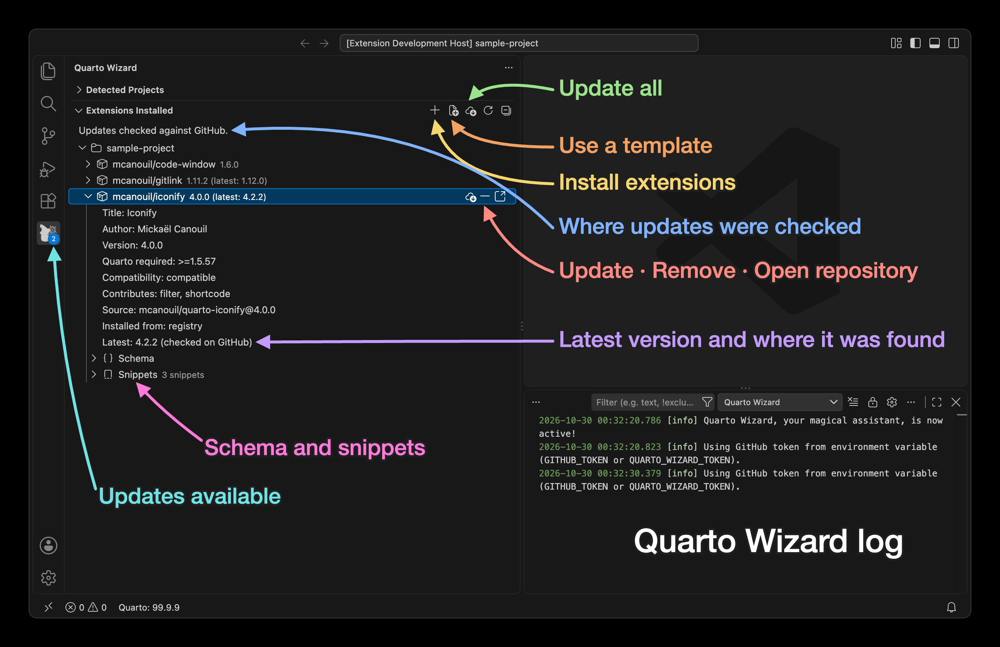

# Manage Installed Extensions

The Explorer View lists the extensions that are installed in your workspace folders.

## What the View Shows

- **Installed extensions** for each project root.
- **Update indicators** when a newer version is available.
- **Compatibility** with your Quarto version, from `quarto-required`.
- **Schema and Snippets** nodes for the extensions that provide them.

## What You Can Do

- **Update** one extension, or use **Update All** in the title bar.
- **Remove** an extension.
- **Open Source** to see the GitHub repository of an extension.

A line at the top of the view tells you where the update check looked.
If it reads `Updates checked against the registry. Sign in to GitHub to see new tags straight away.`, select **Sign In** in the title bar to check GitHub instead.

[Open Explorer View](command:workbench.view.extension.quarto-wizard-explorer)

[Full guide](https://m.canouil.dev/quarto-wizard/getting-started/explorer-view.html)
