The Quarto Wizard Explorer View provides a dedicated interface for managing installed Quarto extensions across your workspace folders, including extension metadata, compatibility, schema contributions, and snippets.

## Opening the Explorer View

There are two ways to open the Explorer View:

1. Click the Quarto Wizard icon in the Activity Bar (sidebar).
2. Use the Command Palette: `Quarto Wizard: Focus on Extensions Installed View`.

## Interface Overview

::: {style="text-align: center;"}
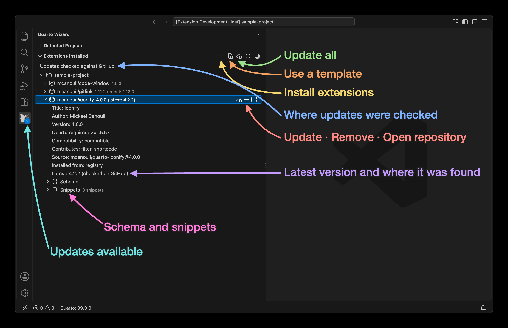{
.dark-content .lightbox
.img-fluid .img-thumbnail .rounded-3 .border-light
fig-align="center" group="quarto-wizard-dark"
fig-alt=''
}
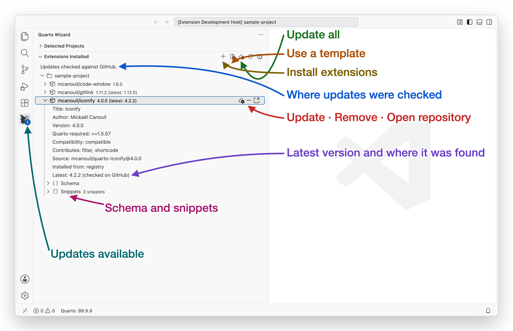{
.light-content .lightbox
.img-fluid .img-thumbnail .rounded-3 .border-light
fig-align="center" group="quarto-wizard-light"
fig-alt=''
}
:::

The Explorer View displays:

- **Project roots**: Each shown Quarto project that can contain extensions, starting with the workspace folder itself.
- **Installed extensions**: Extensions found in the `_extensions` directory.
- **Extension details**: Metadata rows such as title, author, version, `quarto-required`, compatibility, contributes (filters, shortcodes, formats, etc.), repository, and source.
- **Schema contributions**: A `Schema` node when the extension provides a valid `_schema.yml`, `_schema.yaml`, or `_schema.json`.
- **Extension snippets**: A `Snippets` node when snippets are declared via `_snippets.json`.
- **Version information**: Current version and available updates.
- **Action buttons**: Quick access to common operations.

::: {.callout-note}
Quarto Wizard finds the workspace folder and each subfolder, down to two levels, that holds a `_quarto.yml` file, a `_quarto.yaml` file or installed extensions.
It also finds each extension that holds other extensions in its own `_extensions/`.
The editor settings `files.exclude` and `search.exclude` hide folders from this search.
:::

## Detected Projects

The Detected Projects view sits above the Extensions Installed view.
It starts collapsed.
Click its title to open it.
It lists each project that Quarto Wizard found, with a checkbox.
Only the projects with a tick appear in the Extensions Installed view.

::: {style="text-align: center;"}
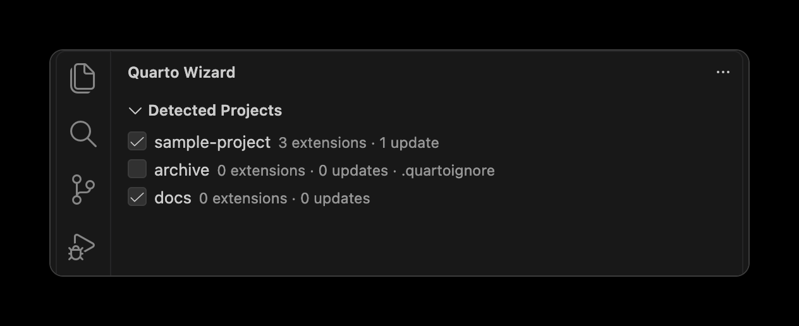{
.dark-content .lightbox
.img-fluid .img-thumbnail .rounded-3 .border-light
fig-align="center" group="quarto-wizard-dark"
fig-alt=''
}
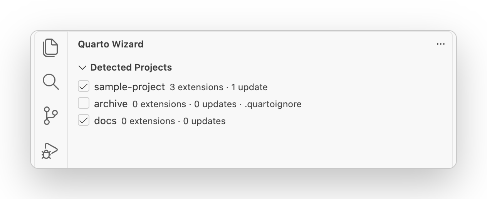{
.light-content .lightbox
.img-fluid .img-thumbnail .rounded-3 .border-light
fig-align="center" group="quarto-wizard-light"
fig-alt=''
}
:::

A hidden project does not count in the update badge, and Update All does not update it.
Completion, diagnostics and the install picker still use the extensions of a hidden project.
A hidden project stays available as an install target.

A project starts hidden in these cases:

- A `.quartoignore` file of the workspace folder matches the project.
- The project is an installed extension that holds other extensions in its own `_extensions/`.
  It has an install record or a `source` in its `_extension.yml`.

To change what is shown:

- Tick or clear a checkbox in the Detected Projects view.
- Run `Quarto Wizard: Select Projects to Show` to choose from a list.
- Right-click a project in the Extensions Installed view, then select **Hide Project**.

Your choices stay on your machine and do not change the workspace files.
To share them, select **Save to Workspace Settings**.
This command writes the `quartoWizard.projectVisibility` setting.
See the [Configuration Reference](../reference/configuration.qmd) for the format.

## Embedded Extensions

An extension can hold other extensions in its own `_extensions/`.
Quarto Wizard shows these extensions as projects too.

- If the parent extension is installed, the embedded extensions are read-only.
  Quarto Wizard does not update or remove them.
  Update the parent extension instead.
- If you develop the parent extension locally, the embedded extensions update as usual.
- If an extension embeds itself, the tree shows an error icon with the description `embeds itself`, and offers no update for it.

## Extension Status Indicators

Extensions may display different indicators:

- **Update available**: A cloud icon indicates a newer version is available.
- **Warning state**: A warning icon indicates an `_extension.yml` parse error, missing source information (no install record), or an incompatible `quarto-required` constraint.

## Compatibility Status

When an extension is expanded, the details include:

- **Quarto required**: The extension `quarto-required` constraint from `_extension.yml`.
- **Compatibility**: One of `compatible`, `incompatible`, `not specified`, or `unknown (Quarto unavailable)`.

If compatibility is `incompatible`, Quarto Wizard adds a warning on the extension item and details in the tooltip.

::: {style="text-align: center;"}
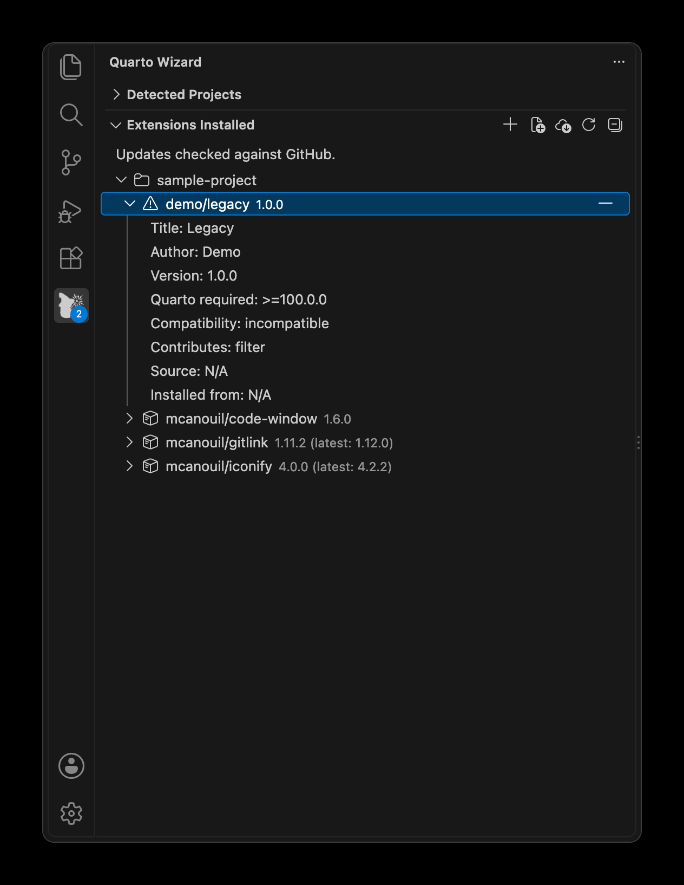{
.dark-content .lightbox
.img-fluid .img-thumbnail .rounded-3 .border-light
width="450px" fig-align="center" group="quarto-wizard-dark"
fig-alt=''
}
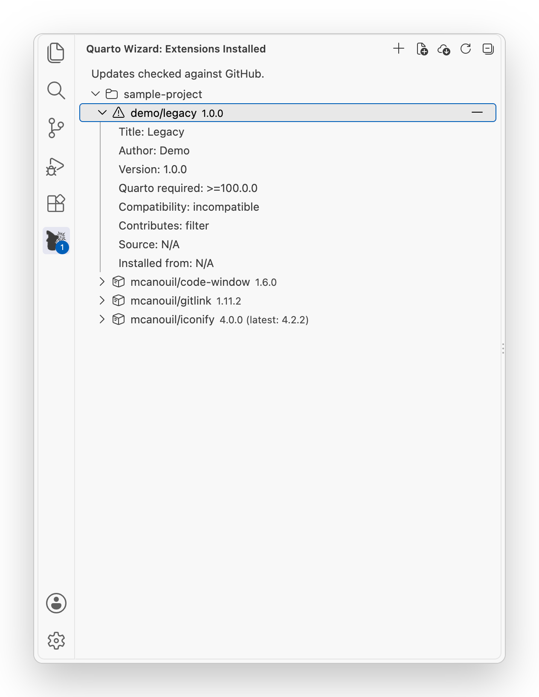{
.light-content .lightbox
.img-fluid .img-thumbnail .rounded-3 .border-light
width="450px" fig-align="center" group="quarto-wizard-light"
fig-alt=''
}
:::

## Schema and Snippet Nodes

If an extension includes schema contributions, the Explorer View shows a `Schema` node with grouped sections:

- **Options**.
- **Shortcodes**.
- **Formats**.
- **Projects**.
- **Attributes**.
- **Classes**.
- **Cells**.

If the schema file cannot be parsed, the tree displays `Schema (invalid)` with a warning.

::: {style="text-align: center;"}
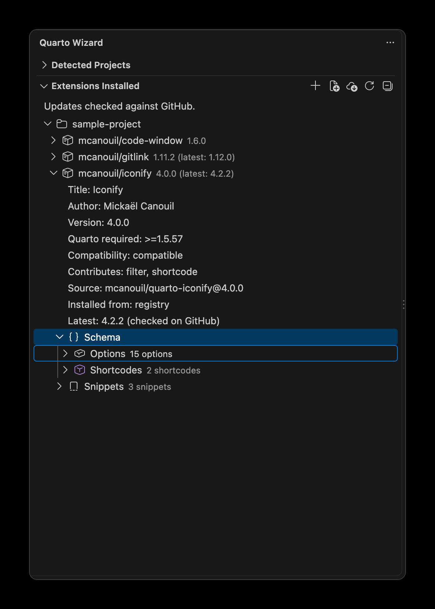{
.dark-content .lightbox
.img-fluid .img-thumbnail .rounded-3 .border-light
width="450px" fig-align="center" group="quarto-wizard-dark"
fig-alt=''
}
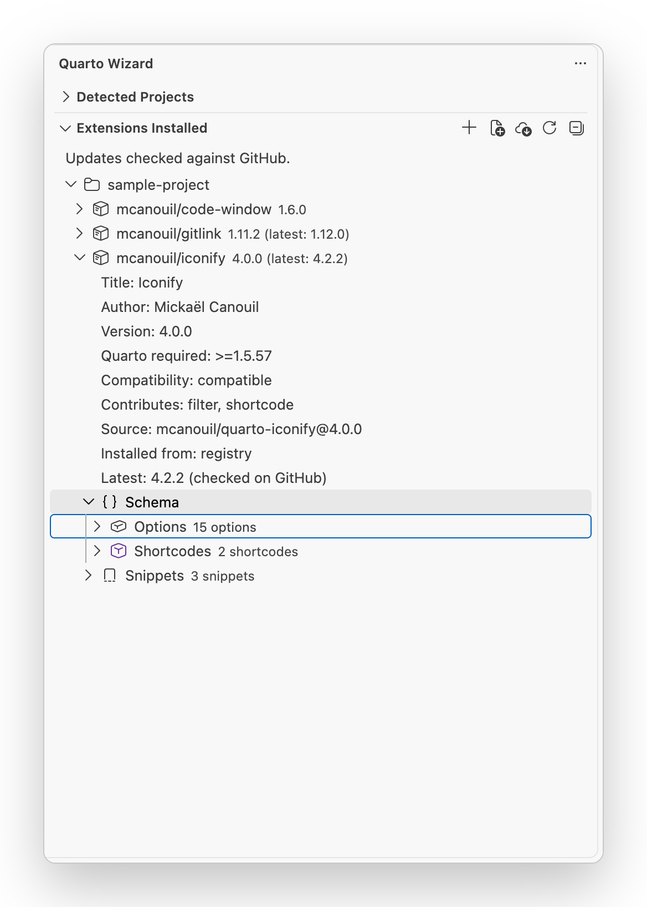{
.light-content .lightbox
.img-fluid .img-thumbnail .rounded-3 .border-light
width="450px" fig-align="center" group="quarto-wizard-light"
fig-alt=''
}
:::

If an extension includes snippets, the Explorer View shows a `Snippets` node with one item per snippet definition.
Each snippet entry displays its namespace-qualified trigger prefix.
Hovering over a snippet item shows a tooltip with its description and a preview of its content.
Selecting a snippet inserts its content into the active editor.
If no editor is open, a prompt asks you to open a file first.
If snippets cannot be parsed, the tree displays `Snippets (invalid)` with a warning.

::: {style="text-align: center;"}
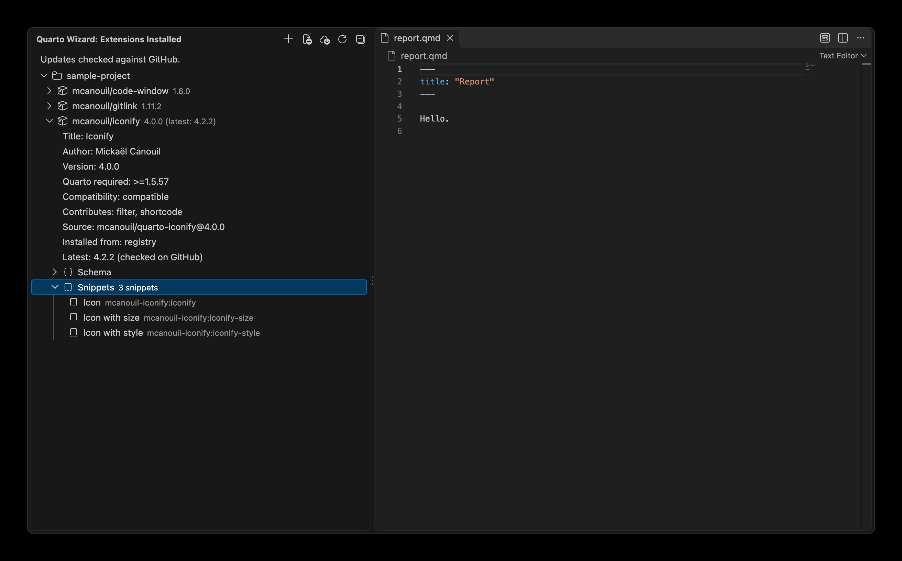{
.dark-content .lightbox
.img-fluid .img-thumbnail .rounded-3 .border-light
fig-align="center" group="quarto-wizard-dark"
fig-alt=''
}
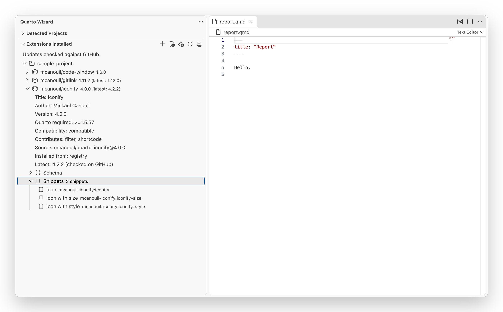{
.light-content .lightbox
.img-fluid .img-thumbnail .rounded-3 .border-light
fig-align="center" group="quarto-wizard-light"
fig-alt=''
}
:::

## Available Actions

### Workspace Folder Actions

For each workspace folder, you can:

- **Install Extensions**: Add new extensions to the folder.
- **Use Template**: Install a template and copy its files.
- **Remove Multiple**: Select and remove multiple extensions at once.

### Extension Actions

For each installed extension, you can:

- **Update**: Check GitHub and install the update that the update source gives.
  In tag mode, this is a newer tag.
  In branch mode, this is a newer commit.
  When nothing is newer, the message `Extension "<name>" is up to date.` appears.
- **Change Update Source**: Switch a GitHub extension between the latest tag and the default branch.
  See [Update Source](installing-extensions.qmd#update-source).
- **Remove**: Delete the extension from the `_extensions` directory.
- **Open Source**: View the extension's GitHub repository (if source is available).
- **Reveal in Explorer View**: Open the extension folder in the file explorer.

### Project Actions

For each project row, you can:

- **Hide Project**: Remove the project from the Extensions Installed view.
  Use the Detected Projects view to show it again.

### Snippet Actions

For each snippet entry shown under an extension, you can:

- **Insert Snippet**: Insert the selected snippet at the cursor position in the active editor.

## Toolbar Actions

The view toolbar provides:

- **Install Extensions**: Open the extension browser.
- **Use Template**: Open the template browser.
- **Update All**: Update all outdated extensions in the workspace to their latest GitHub tag.
- **Refresh**: Reload the list of installed extensions.

The tree updates automatically after installations, updates, removals, and local file changes.
Use **Refresh** when you need to force a manual reload.

## Update Detection

Quarto Wizard can detect when updates are available for your installed extensions.

::: {.callout-important}
Extensions can only be updated if they have an install record, which Quarto Wizard and Quarto 2 write when they install an extension.
An extension can also have `source: <owner>/<repository>` in its `_extension.yml` file, the format of Quarto Wizard 3.
If an extension has neither, or its install record cannot be read, Quarto Wizard cannot check it for updates.
To correct this, remove the extension, then install it again with Quarto Wizard.
An install over the installed copy is not sufficient, because Quarto Wizard writes nothing when the version is the same.
See [Install Record](../reference/install-record.qmd).
:::

### Which Version Is Installed

Each update, from the **Update** button or from **Update All**, follows the update source that Quarto Wizard saved for the extension.
By default this is the latest GitHub tag.
In tag mode, the latest tag is the highest semantic version among the releases and tags of the repository.
Prereleases are only considered when the installed version is a prerelease.
An update never installs a lower version than the one you have.
In branch mode, Quarto Wizard compares the saved commit with the latest commit of the branch, and Update installs that commit.
The branch is the default branch, unless the source names one.
An extension that you installed from a commit follows the latest tag.
If the repository has no version tag, it follows the head of the default branch.
When an extension comes from a subdirectory of a repository, Quarto Wizard compares the installed version with the version in its own `_extension.yml` at the latest tag.

### Where Updates Are Checked

The background check looks up each extension on GitHub first, with or without a token.
A new tag therefore shows as soon as the author publishes it.
While a repository has no version tag, the check compares commits on the default branch.
When you click **Update** or **Update All**, Quarto Wizard also looks up GitHub, with or without a token.
Quarto Wizard 4.0.0 removes the `quartoWizard.update.crossSource` setting, which no longer has an effect.

GitHub can refuse a check.
The usual cause is the rate limit, but a rejected token or a lost connection has the same result.
When GitHub refuses, the background check uses the registry for each extension that GitHub did not answer.
The registry refreshes once a day, so it can be a little behind GitHub.
The extensions that GitHub answered keep their GitHub result.

Only an extension that the registry lists can use the registry.
An extension from a subdirectory of a repository, or from a named branch, never uses the registry.
If GitHub refuses one of these extensions, or an extension that the registry does not list, it is not checked.
When other extensions used the registry, the log names each extension that was not checked.
When no extension could use the registry, the update check fails.

Each check uses the GitHub API:

- About 2 requests for each extension that follows the latest tag (`/releases` and `/tags`).
- 1 request for each extension that follows a named branch (`/commits`).
  An extension that follows the default branch uses no API request.
- 1 more request (`/compare`) for some extensions from a subdirectory of a repository.

Extensions from the same repository share their requests.
Quarto Wizard checks for updates when it starts, when the view opens, when you select **Refresh**, and after each install, update, or removal.
Without a token, GitHub accepts 60 requests in one hour for each IP address.
With a token, the limit is 5,000 requests in one hour.

A line at the top of the view shows which source was used:

- `Updates checked against GitHub.`
- `Updates checked against the registry because GitHub did not answer. Sign in to GitHub to raise the rate limit.`
- `Updates checked against the registry because GitHub did not answer. Show log.`, when you are signed in or a token is set.
- `Update check failed. Show log.`, when GitHub refused and the registry could not help either.

The title bar of the view can show one button for this line:

- **Sign In** appears only when updates were checked against the registry and you are not signed in.
- **Show Log** appears when the update check failed, or when updates were checked against the registry and you are signed in.
  The log gives the reason that GitHub did not answer, for example a token that GitHub rejected.

Neither button appears when updates were checked against GitHub, or when no extensions are installed.
You can always run `Quarto Wizard: Sign In with GitHub Session` from the Command Palette.
To sign in or to set a token, see [Optional: GitHub Authentication](installation.qmd#optional-github-authentication).

Hover over an extension to see its latest version and where it was found.
The tooltip also shows `Updates from: latest tag`, `Updates from: default branch`, `Updates from: <ref> branch`, or `Updates from: default branch until the first version tag`.
The details of an extension show `Installed from:`.
When an update is available, they also show `Latest:` with the version and the source of the check, for example `Latest: 1.2.0 (checked on GitHub)`.

Quarto Wizard records the source in the `.quarto-source.yml` file of the extension, and does not change `_extension.yml`.
Quarto 2 reads the same file.
See [Install Record](../reference/install-record.qmd).

### Local Changes

An update does not replace an extension that has local changes.
**Update** shows a warning, and **Update All** skips the extension.
See [Local Changes](installing-extensions.qmd#local-changes) for details.

## Visibility

The Explorer View panel is only visible when at least one workspace folder is open.
If no extensions are installed, the view displays a welcome message with links to install extensions, use a template, use a brand, or browse the extensions directory.

## Context Menu

Right-click on an extension to access additional options:

- Reinstall Extension.
  It keeps the update source and installs the recorded tag or commit again, even at the same version.
  It warns before it removes local changes.
- Change Update Source (for an extension installed from GitHub).
- Update Extension (for an extension installed from GitHub or from the registry, even when it is up to date).
- Remove Extension.
- Open Extension Source (if source is available).
- Reveal in Explorer View.

::: {style="text-align: center;"}
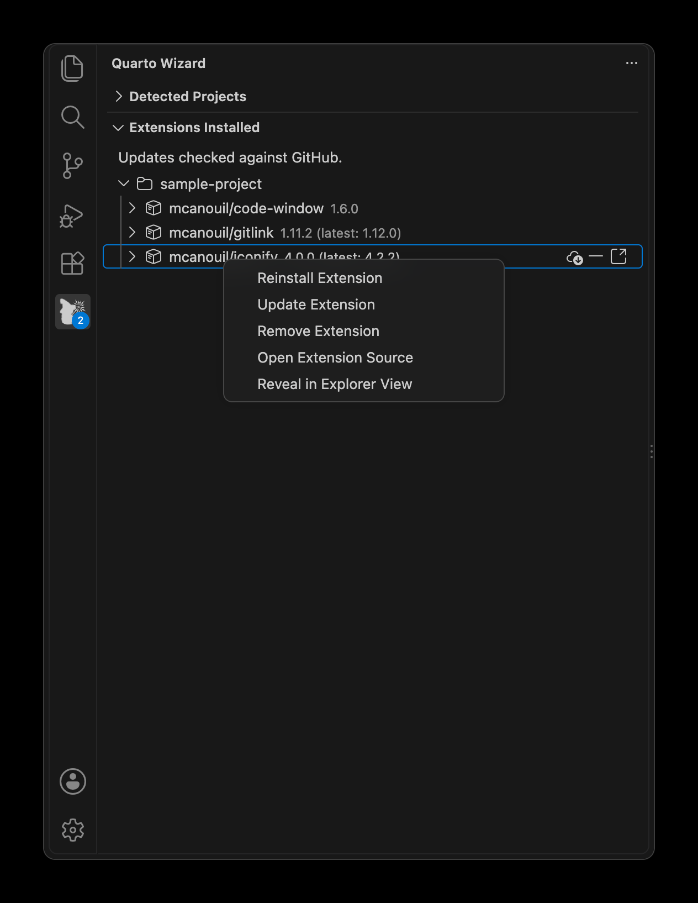{
.dark-content .lightbox
.img-fluid .img-thumbnail .rounded-3 .border-light
fig-align="center" group="quarto-wizard-dark"
fig-alt=''
}
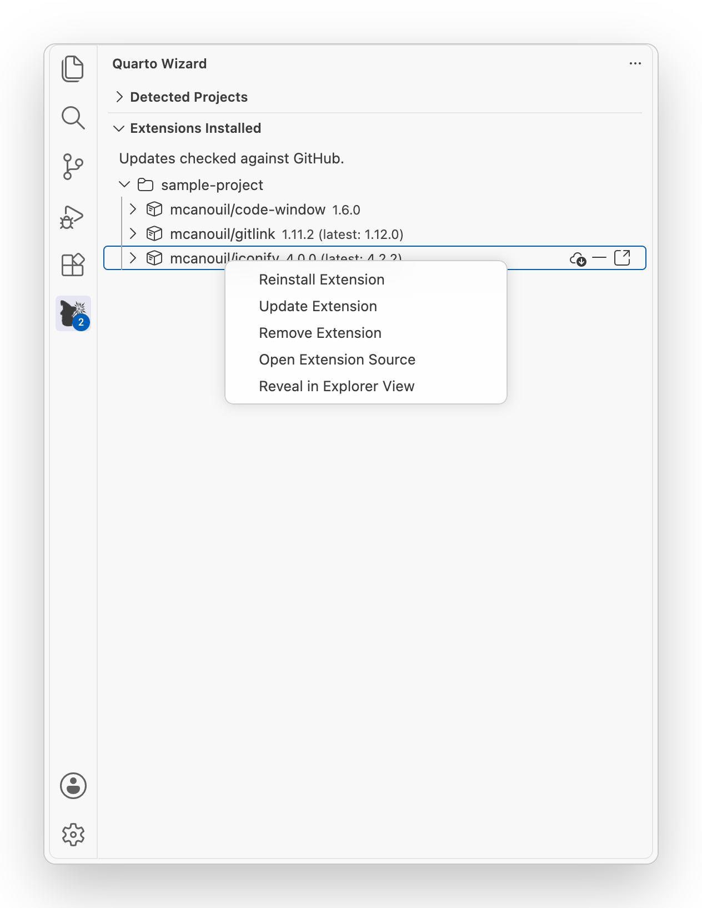{
.light-content .lightbox
.img-fluid .img-thumbnail .rounded-3 .border-light
fig-align="center" group="quarto-wizard-light"
fig-alt=''
}
:::

You can also access Quarto Wizard commands from the editor context menu:

::: {style="text-align: center;"}
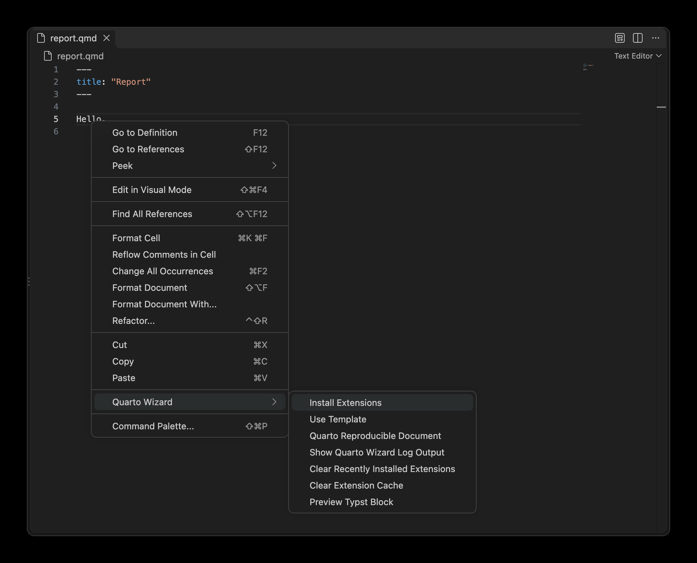{
.dark-content .lightbox
.img-fluid .img-thumbnail .rounded-3 .border-light
fig-align="center" group="quarto-wizard-dark"
fig-alt=''
}
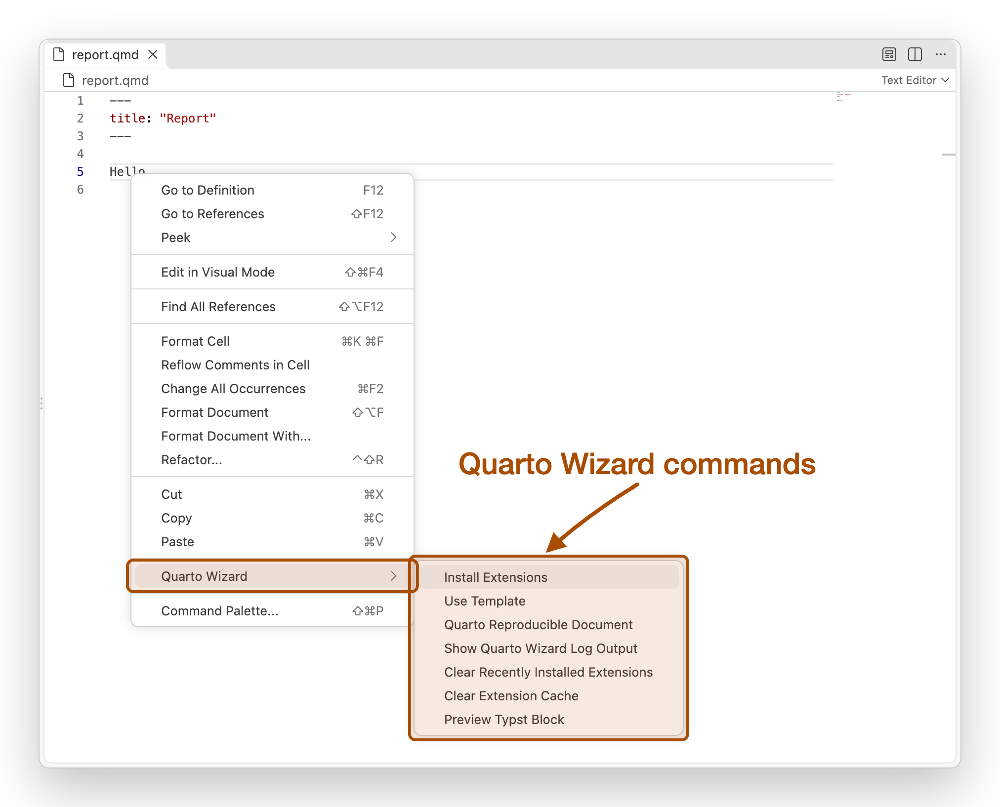{
.light-content .lightbox
.img-fluid .img-thumbnail .rounded-3 .border-light
fig-align="center" group="quarto-wizard-light"
fig-alt=''
}
:::
