The Quarto Wizard Explorer View provides a dedicated interface for managing installed Quarto extensions across your workspace folders, including extension metadata, compatibility, schema contributions, and snippets.

## Opening the Explorer View

There are two ways to open the Explorer View:

1. Click the Quarto Wizard icon in the Activity Bar (sidebar).
2. Use the Command Palette: `Quarto Wizard: Focus on Extensions Installed View`.

## Interface Overview

::: {style="text-align: center;"}
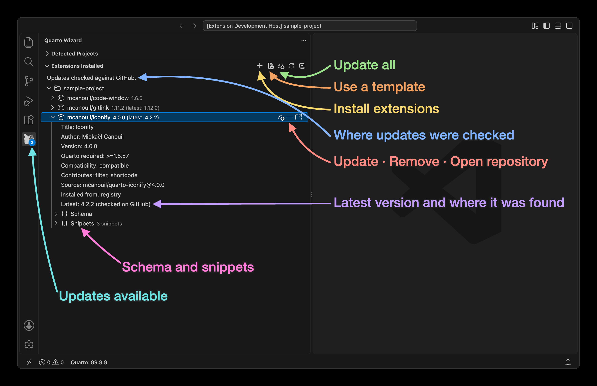{
.dark-content .lightbox
.img-fluid .img-thumbnail .rounded-3 .border-light
fig-align="center" group="quarto-wizard-dark"
fig-alt=''
}
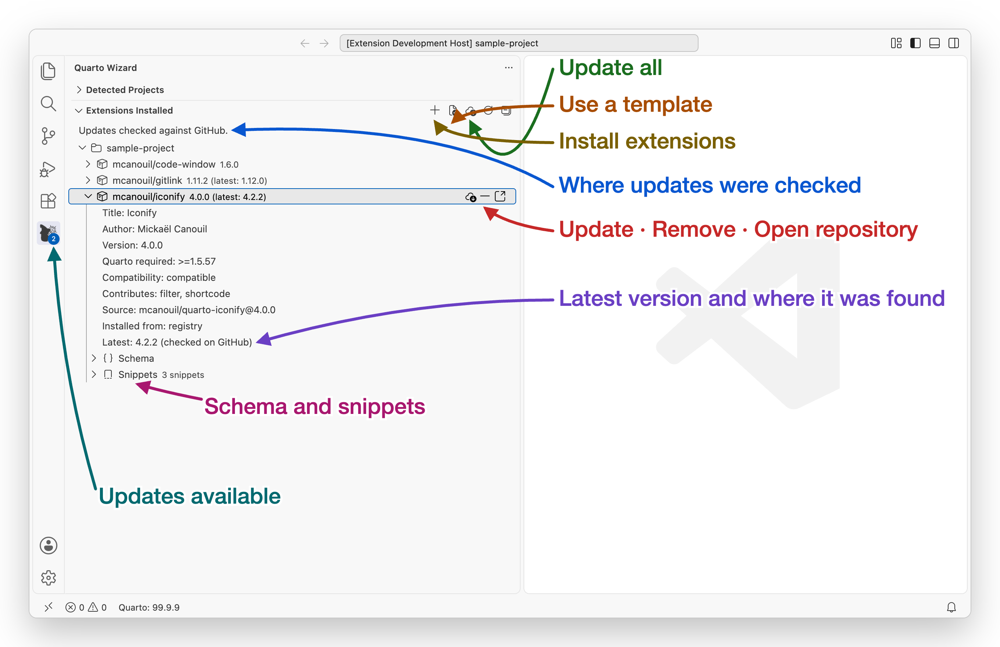{
.light-content .lightbox
.img-fluid .img-thumbnail .rounded-3 .border-light
fig-align="center" group="quarto-wizard-light"
fig-alt=''
}
:::

The Explorer View displays:

- **Project roots**: Each detected Quarto project root that can contain extensions, starting with the workspace folder itself.
- **Installed extensions**: Extensions found in the `_extensions` directory.
- **Extension details**: Metadata rows such as title, author, version, `quarto-required`, compatibility, contributes (filters, shortcodes, formats, etc.), repository, and source.
- **Schema contributions**: A `Schema` node when the extension provides a valid `_schema.yml`, `_schema.yaml`, or `_schema.json`.
- **Extension snippets**: A `Snippets` node when snippets are declared via `_snippets.json`.
- **Version information**: Current version and available updates.
- **Action buttons**: Quick access to common operations.

::: {.callout-note}
When the workspace folder itself holds at least one installed extension in `_extensions/`, it is the only root shown, and no subfolder is listed as a separate target.
Paths matched by the workspace folder's `.quartoignore` are never detected as roots either, so listing `docs` there keeps a documentation website out of the view.
See [Auto Project Detection](../reference/configuration.qmd#auto-project-detection) for the scanning modes.
:::

## Extension Status Indicators

Extensions may display different indicators:

- **Update available**: A cloud icon indicates a newer version is available.
- **Warning state**: A warning icon indicates an `_extension.yml` parse error, missing source information, or an incompatible `quarto-required` constraint.

## Compatibility Status

When an extension is expanded, the details include:

- **Quarto required**: The extension `quarto-required` constraint from `_extension.yml`.
- **Compatibility**: One of `compatible`, `incompatible`, `not specified`, or `unknown (Quarto unavailable)`.

If compatibility is `incompatible`, Quarto Wizard adds a warning on the extension item and details in the tooltip.

::: {style="text-align: center;"}
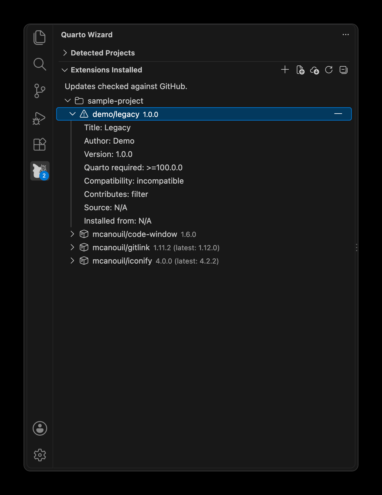{
.dark-content .lightbox
.img-fluid .img-thumbnail .rounded-3 .border-light
width="450px" fig-align="center" group="quarto-wizard-dark"
fig-alt=''
}
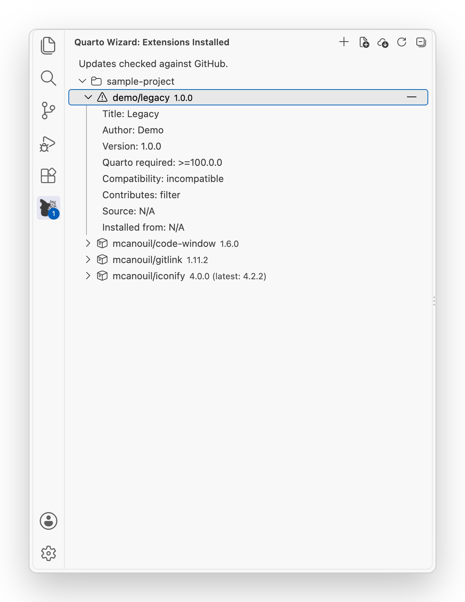{
.light-content .lightbox
.img-fluid .img-thumbnail .rounded-3 .border-light
width="450px" fig-align="center" group="quarto-wizard-light"
fig-alt=''
}
:::

## Schema and Snippet Nodes

If an extension includes schema contributions, the Explorer View shows a `Schema` node with grouped sections:

- **Options**.
- **Shortcodes**.
- **Formats**.
- **Projects**.
- **Element Attributes**.

If the schema file cannot be parsed, the tree displays `Schema (invalid)` with a warning.

::: {style="text-align: center;"}
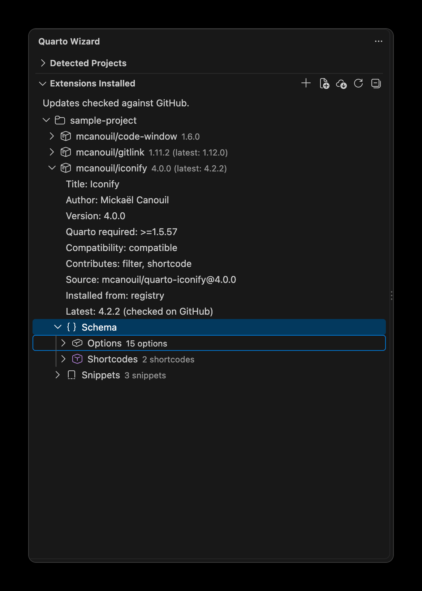{
.dark-content .lightbox
.img-fluid .img-thumbnail .rounded-3 .border-light
width="450px" fig-align="center" group="quarto-wizard-dark"
fig-alt=''
}
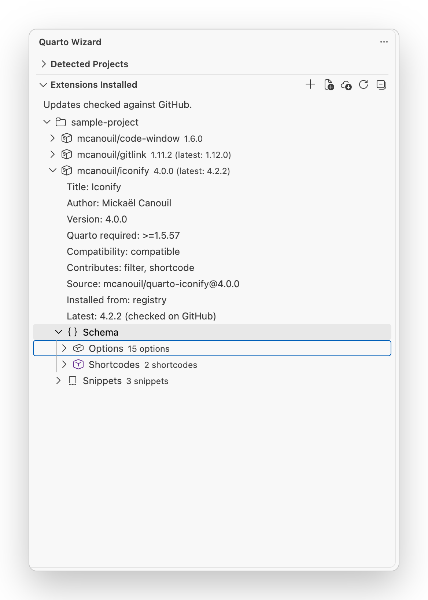{
.light-content .lightbox
.img-fluid .img-thumbnail .rounded-3 .border-light
width="450px" fig-align="center" group="quarto-wizard-light"
fig-alt=''
}
:::

If an extension includes snippets, the Explorer View shows a `Snippets` node with one item per snippet definition.
Each snippet entry displays its namespace-qualified trigger prefix.
Hovering over a snippet item shows a tooltip with its description and a preview of its content.
Selecting a snippet inserts its content into the active editor.
If no editor is open, a prompt asks you to open a file first.
If snippets cannot be parsed, the tree displays `Snippets (invalid)` with a warning.

::: {style="text-align: center;"}
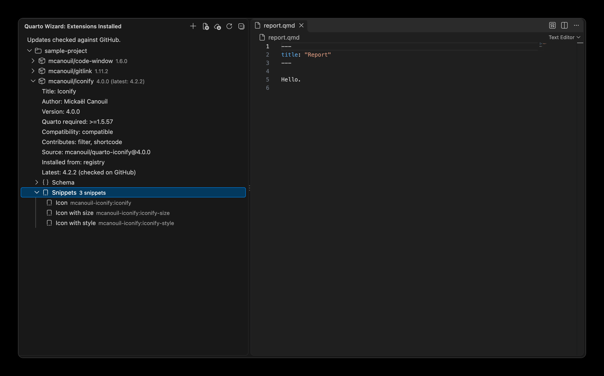{
.dark-content .lightbox
.img-fluid .img-thumbnail .rounded-3 .border-light
fig-align="center" group="quarto-wizard-dark"
fig-alt=''
}
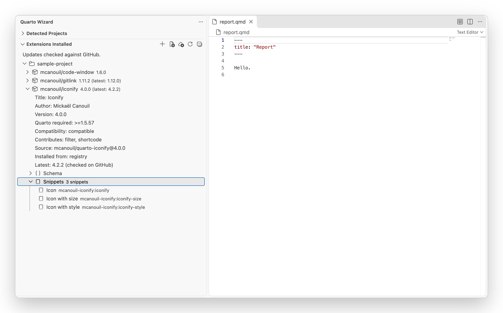{
.light-content .lightbox
.img-fluid .img-thumbnail .rounded-3 .border-light
fig-align="center" group="quarto-wizard-light"
fig-alt=''
}
:::

## Available Actions

### Workspace Folder Actions

For each workspace folder, you can:

- **Install Extensions**: Add new extensions to the folder.
- **Use Template**: Install a template and copy its files.
- **Remove Multiple**: Select and remove multiple extensions at once.

### Extension Actions

For each installed extension, you can:

- **Update**: Check GitHub and install the latest GitHub tag when it is newer.
  When nothing is newer, the message `Extension "<name>" is up to date.` appears.
- **Remove**: Delete the extension from the `_extensions` directory.
- **Open Source**: View the extension's GitHub repository (if source is available).
- **Reveal in Explorer View**: Open the extension folder in the file explorer.

### Snippet Actions

For each snippet entry shown under an extension, you can:

- **Insert Snippet**: Insert the selected snippet at the cursor position in the active editor.

## Toolbar Actions

The view toolbar provides:

- **Install Extensions**: Open the extension browser.
- **Use Template**: Open the template browser.
- **Update All**: Update all outdated extensions in the workspace to their latest GitHub tag.
- **Refresh**: Reload the list of installed extensions.

The tree updates automatically after installations, updates, removals, and local file changes.
Use **Refresh** when you need to force a manual reload.

## Update Detection

Quarto Wizard can detect when updates are available for your installed extensions.

::: {.callout-important}
Extensions can only be updated if they were installed by Quarto Wizard or have `source: <owner>/<repository>` in their `_extension.yml` file.
You can manually add the source field to enable update detection.
:::

### Which Version Is Installed

Each update, from the **Update** button or from **Update All**, installs the latest GitHub tag.
This is the highest semantic version among the releases and tags of the repository.
Prereleases are only considered when the installed version is a prerelease.
An update never installs a lower version than the one you have.
When an extension is installed from a commit, Quarto Wizard compares commits instead.
The commit can have between seven and 40 characters, from the short form to the full form.
Update then installs the latest commit of the default branch.
Quarto Wizard does not check an extension installed from a subdirectory of a repository, such as `owner/repository/subdirectory`, for updates.

### Where Updates Are Checked

The background check uses GitHub when you are signed in to GitHub or when a token is set.
Otherwise, it uses the registry, which can be a little behind GitHub.
An extension that the registry does not list is still checked on GitHub, without a token.
An extension installed from a repository that has no tags records a commit, so the check compares commits.
When you click **Update** or **Update All**, Quarto Wizard looks up GitHub, with or without a token.
Quarto Wizard 4.0.0 removes the `quartoWizard.update.crossSource` setting, which no longer has an effect.

A line at the top of the view shows which source was used:

- `Updates checked against GitHub.`
- `Updates checked against the registry. Sign in to GitHub to see new tags straight away.`
- `Update check failed. Show log.`

The title bar of the view can show one button for this line:

- **Sign In** appears only when updates were checked against the registry.
- **Show Log** appears only when the update check failed.

Neither button appears when updates were checked against GitHub, or when no extensions are installed.
You can always run `Quarto Wizard: Sign In with GitHub Session` from the Command Palette.
To sign in or to set a token, see [Optional: GitHub Authentication](installation.qmd#optional-github-authentication).

Hover over an extension to see its latest version and where it was found.
The details of an extension show `Installed from:`.
When an update is available, they also show `Latest:` with the version and the source of the check, for example `Latest: 1.2.0 (checked on GitHub)`.

Quarto Wizard records `source` and `source-type` by editing those two lines only.
The rest of `_extension.yml` is left byte for byte identical, so comments, key order, and quoting written by the extension author are preserved.

## Visibility

The Explorer View panel is only visible when at least one workspace folder is open.
If no extensions are installed, the view displays a welcome message with links to install extensions, use a template, use a brand, or browse the extensions directory.

## Context Menu

Right-click on an extension to access additional options:

- Update (for an extension installed from GitHub or from the registry, even when it is up to date).
- Remove.
- Open Source (if source is available).
- Reveal in Explorer View.

::: {style="text-align: center;"}
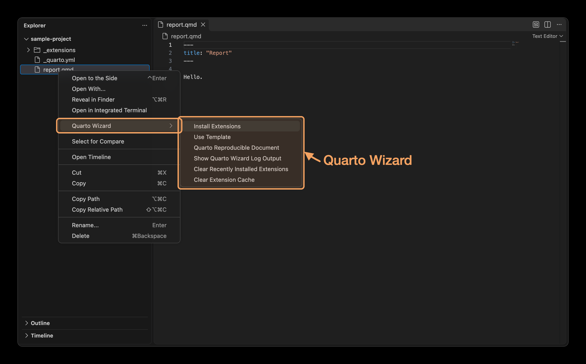{
.dark-content .lightbox
.img-fluid .img-thumbnail .rounded-3 .border-light
fig-align="center" group="quarto-wizard-dark"
fig-alt=''
}
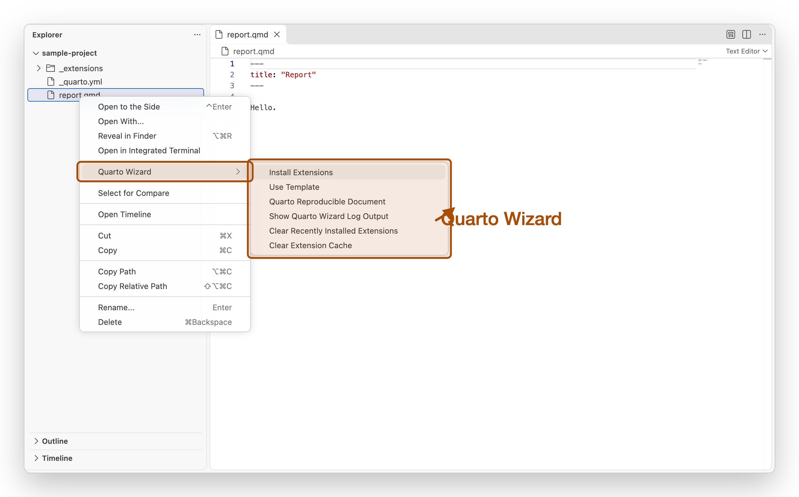{
.light-content .lightbox
.img-fluid .img-thumbnail .rounded-3 .border-light
fig-align="center" group="quarto-wizard-light"
fig-alt=''
}
:::

You can also access Quarto Wizard commands from the editor context menu:

::: {style="text-align: center;"}
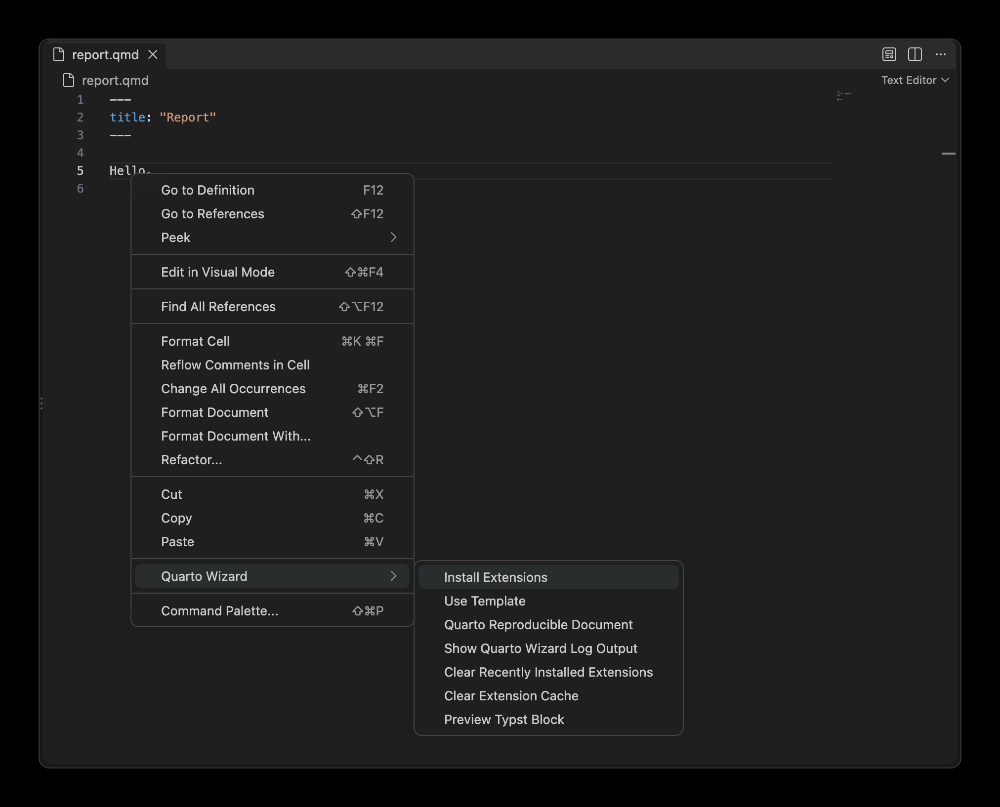{
.dark-content .lightbox
.img-fluid .img-thumbnail .rounded-3 .border-light
fig-align="center" group="quarto-wizard-dark"
fig-alt=''
}
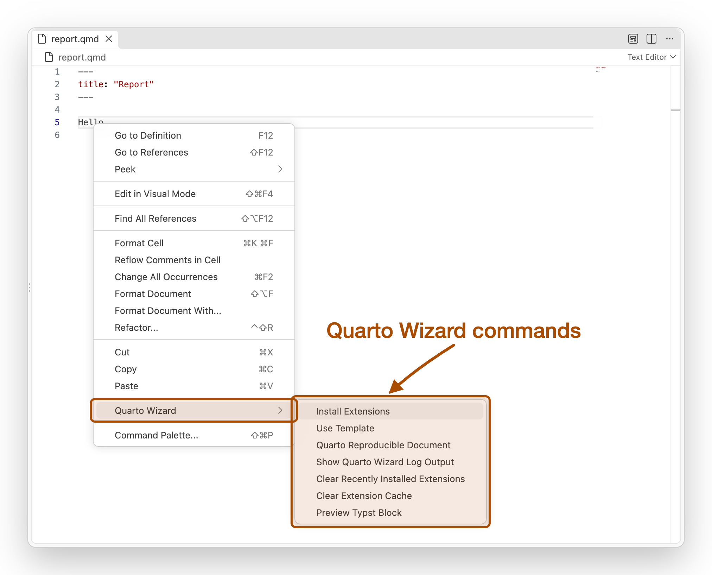{
.light-content .lightbox
.img-fluid .img-thumbnail .rounded-3 .border-light
fig-align="center" group="quarto-wizard-light"
fig-alt=''
}
:::
