Quarto Wizard makes it easy to browse and install Quarto extensions from multiple sources.

## Using the Extension Browser

1. Open the Command Palette (`Ctrl+Shift+P` or `Cmd+Shift+P` on macOS).
2. Type `Quarto Wizard: Install Extensions` and select it.
3. Select an installation source (Registry, GitHub, URL, or Local).
4. For Registry: optionally filter by extension type, then browse the list.

::: {layout-ncol="3"}

::: {style="text-align: center;"}
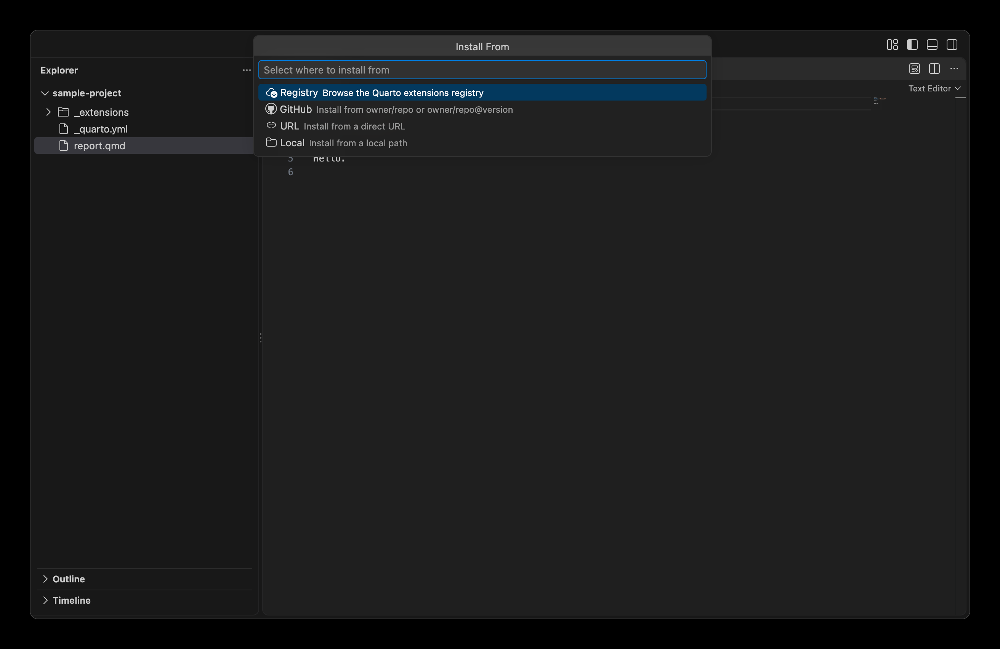{
.dark-content .lightbox
.img-fluid .img-thumbnail .rounded-3 .border-light
fig-align="center" group="quarto-wizard-dark"
fig-alt=''
}
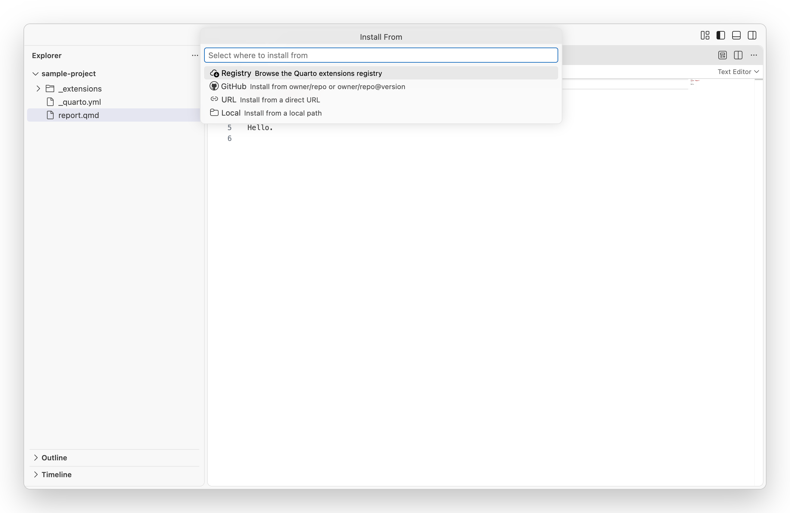{
.light-content .lightbox
.img-fluid .img-thumbnail .rounded-3 .border-light
fig-align="center" group="quarto-wizard-light"
fig-alt=''
}
:::

::: {style="text-align: center;"}
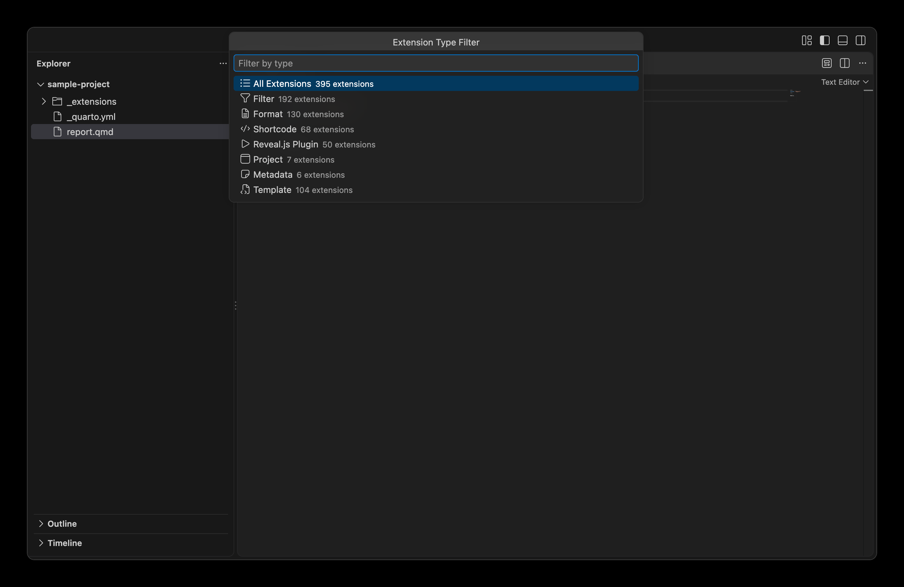{
.dark-content .lightbox
.img-fluid .img-thumbnail .rounded-3 .border-light
fig-align="center" group="quarto-wizard-dark"
fig-alt=''
}
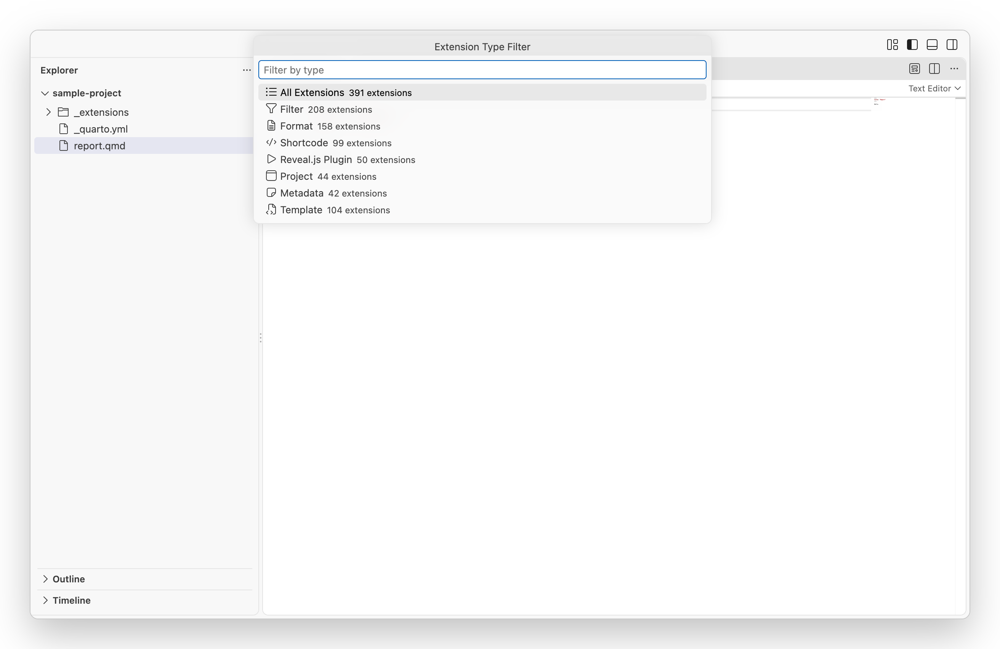{
.light-content .lightbox
.img-fluid .img-thumbnail .rounded-3 .border-light
fig-align="center" group="quarto-wizard-light"
fig-alt=''
}
:::

::: {style="text-align: center;"}
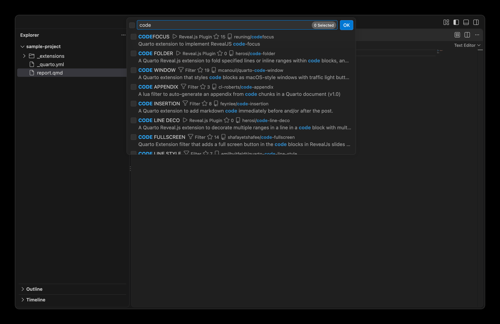{
.dark-content .lightbox
.img-fluid .img-thumbnail .rounded-3 .border-light
fig-align="center" group="quarto-wizard-dark"
fig-alt=''
}
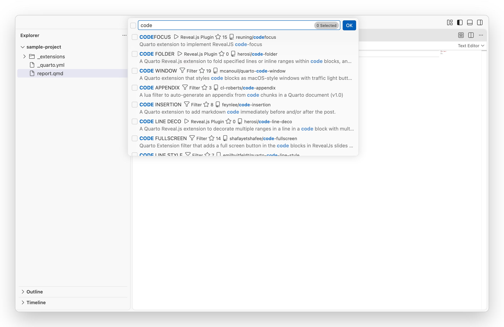{
.light-content .lightbox
.img-fluid .img-thumbnail .rounded-3 .border-light
fig-align="center" group="quarto-wizard-light"
fig-alt=''
}
:::

:::

## Browsing Extensions

The extension browser displays:

- **Extension name**: The name of the extension.
- **Author**: The extension's creator.
- **Version**: The latest available version.
- **Stars**: GitHub star count.
- **Description**: A brief description of what the extension does.
- **Licence**: The extension's licence type.

You can:

- **Search**: Type to filter extensions by name, author, or description.
- **Sort**: Order by name, stars, or recently updated.
- **Filter**: Show only specific types of extensions.

## Installing an Extension

1. Select the extension(s) you want to install.
2. Press Enter or click to confirm your selection.
3. Choose the workspace folder where the extension should be installed.
4. Confirm the installation when prompted.

The extension will be downloaded and installed to the `_extensions` directory in your chosen workspace folder.

You can also select **Install Extensions** on a folder in the Extensions Installed view.
Quarto Wizard then installs into that folder and does not ask you to choose one.
To update an extension later, see [Update Detection](explorer-view.qmd#update-detection).

## Installation Sources

Quarto Wizard supports installing extensions from multiple sources.
When you run `Quarto Wizard: Install Extensions`, you first choose where to install from:

### From Registry

Browse and install from the official Quarto extensions registry.
After selecting Registry, you can filter by extension type (Filter, Shortcode, Format, etc.) before browsing.

### From GitHub

Install from a GitHub repository using the format `owner/repo` or `owner/repo@version`.
This allows installing specific versions or branches (e.g., `quarto-ext/lightbox@v0.1.6`).

### From URL

Install from a direct archive URL (`.zip` or `.tar.gz`).

### From Local Path

Install from a local directory or archive file.

### Direct Commands

You can also use dedicated commands to skip the source picker:

- `Quarto Wizard: Install Extension from Registry` - Go directly to registry browser.
- `Quarto Wizard: Install Extension from GitHub` - Prompt for GitHub reference.
- `Quarto Wizard: Install Extension from URL` - Prompt for archive URL.
- `Quarto Wizard: Install Extension from Local` - Open file picker dialog.

## Using Brands

Quarto Wizard also provides `Quarto Wizard: Use Brand` to apply Quarto brand assets to your project.
Like extension and template installation, it supports GitHub, URL, and local sources.
Brand files are downloaded to your project's `_brand/` directory.

## Installing from Local Sources

You can install Quarto extensions from local directories or archive files.
This is useful when:

- Sharing extensions between projects.
- Installing extensions from downloaded archives.
- Working with extensions in development.

### Using the Context Menu

Right-click on a folder or archive file (`.zip`, `.tar.gz`, `.tgz`) in the Explorer and select `Quarto Wizard` > `Install Extension from Local`.

::: {style="text-align: center;"}
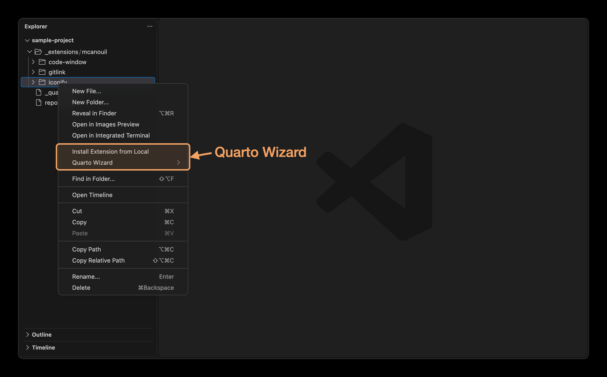{
.dark-content .lightbox
.img-fluid .img-thumbnail .rounded-3 .border-light
width="375px" fig-align="center" group="quarto-wizard-dark"
fig-alt=''
}
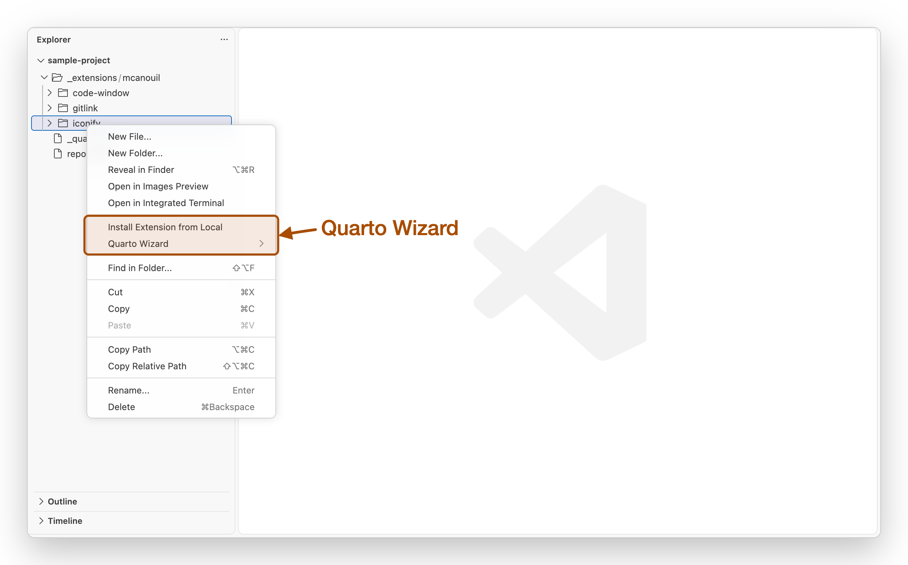{
.light-content .lightbox
.img-fluid .img-thumbnail .rounded-3 .border-light
width="375px" fig-align="center" group="quarto-wizard-light"
fig-alt=''
}
:::

### How It Works

1. Choose the target workspace folder (if multiple workspaces are open).
2. If the source contains multiple extensions, you will be prompted to select which ones to install (see [Extension Selection](#extension-selection)).
3. If an extension already exists, you will be asked to confirm before overwriting (see [Conflict Resolution](#conflict-resolution)).

For archives, Quarto Wizard will extract the contents and look for an `_extensions/` folder.
If the source is a single extension (no `_extensions/` folder), it will be installed directly.

## Extension Selection {#extension-selection}

When a source contains multiple extensions (in an `_extensions/` folder), you can select which extensions to install.
This applies to all installation sources: Registry, GitHub, URL, and local.

::: {style="text-align: center;"}
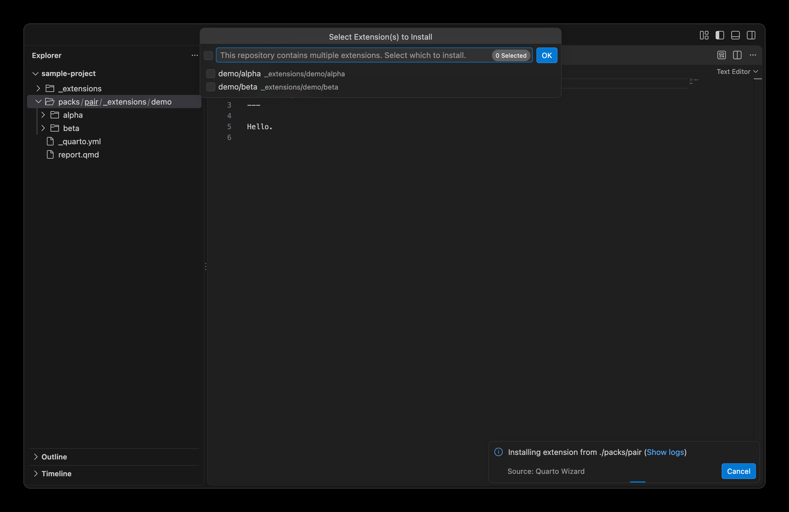{
.dark-content .lightbox
.img-fluid .img-thumbnail .rounded-3 .border-light
fig-align="center" group="quarto-wizard-dark"
fig-alt=''
}
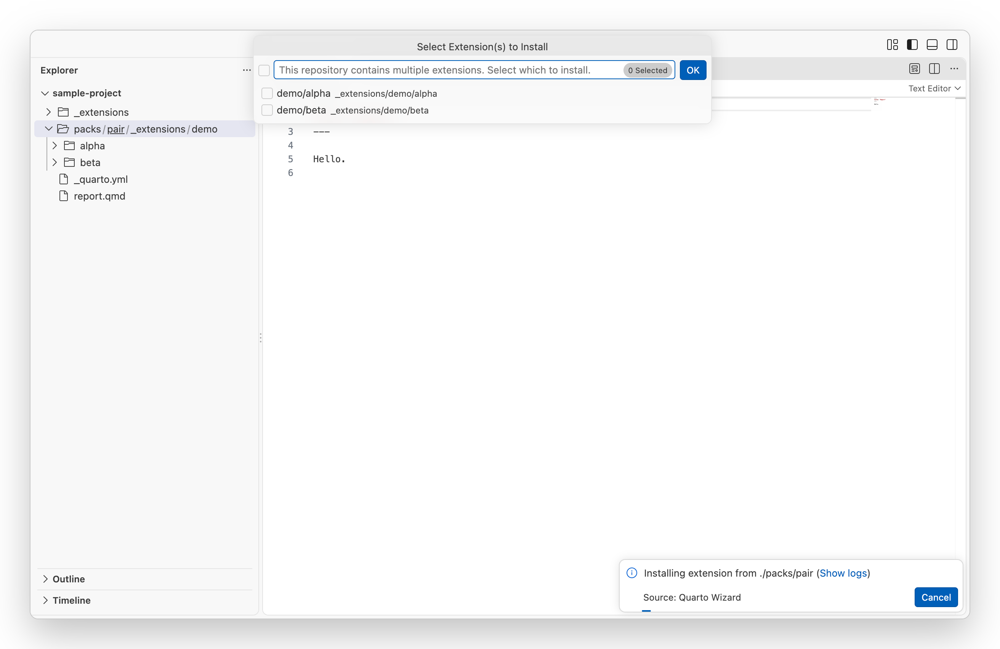{
.light-content .lightbox
.img-fluid .img-thumbnail .rounded-3 .border-light
fig-align="center" group="quarto-wizard-light"
fig-alt=''
}
:::

::: {.callout-tip}
If the source contains a single extension, it is installed directly without prompting.
:::

Two rules narrow what a source offers, so that a repository shipping a single extension does not open this dialog:

- When the repository has its own `_extensions/` directory, copies found elsewhere in the source are not offered.
  This is typically the vendored `docs/_extensions/` of a documentation website built from the same repository.
- Paths matched by the repository's `.quartoignore` are dropped.

Neither rule can empty the list: a source whose extensions all sit in ignored locations still installs.

## Conflict Resolution {#conflict-resolution}

If an extension already exists in the target location, you will be asked to confirm before overwriting.
This applies to all installation sources: Registry, GitHub, URL, and local.

::: {style="text-align: center;"}
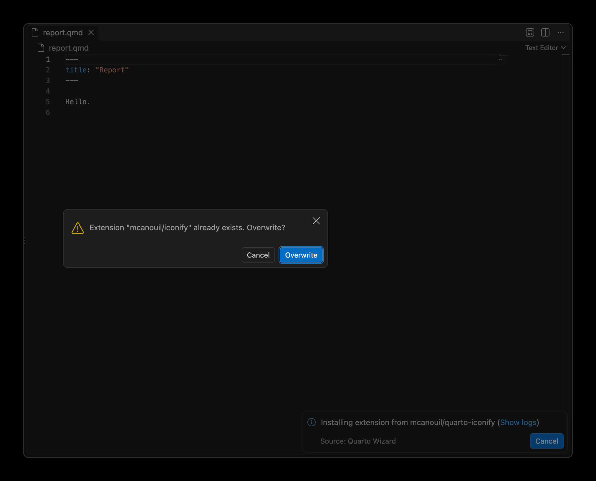{
.dark-content .lightbox
.img-fluid .img-thumbnail .rounded-3 .border-light
fig-align="center" group="quarto-wizard-dark"
fig-alt=''
}
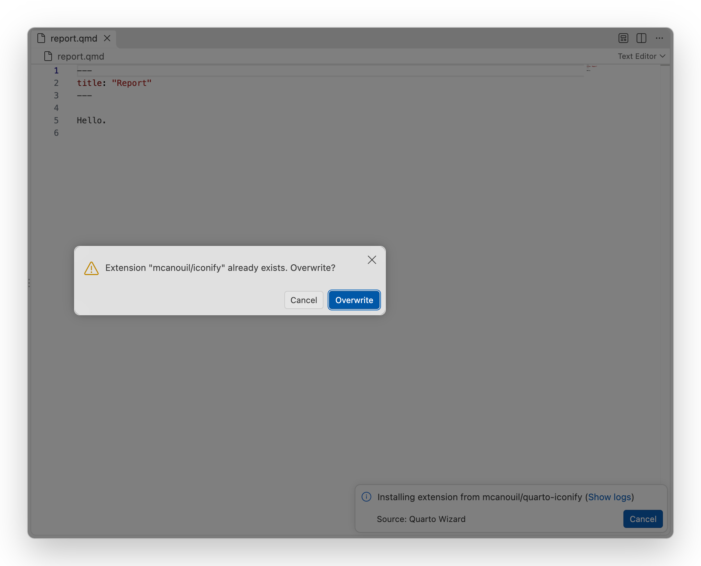{
.light-content .lightbox
.img-fluid .img-thumbnail .rounded-3 .border-light
fig-align="center" group="quarto-wizard-light"
fig-alt=''
}
:::

## Quarto Version Validation

Some extensions specify a minimum Quarto version requirement in their `_extension.yml` file using the `quarto-required` field.
Quarto Wizard validates this requirement before installation if the [Quarto VS Code extension](https://marketplace.visualstudio.com/items?itemName=quarto.quarto) is installed.

### How It Works

1. Before installing, Quarto Wizard checks if the extension specifies a `quarto-required` version.
2. If the Quarto VS Code extension is available, it retrieves your current Quarto CLI version.
3. If your version does not meet the requirement, a warning dialog appears with:
   - The required version.
   - Your current version.
   - Options to "Install Anyway" or "Cancel".

::: {style="text-align: center;"}
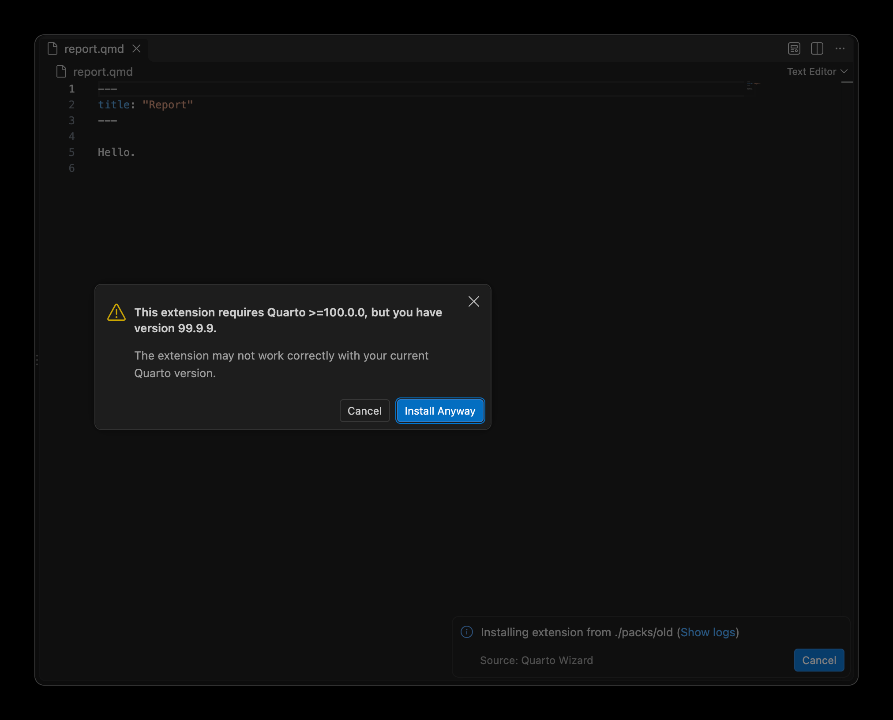{
.dark-content .lightbox
.img-fluid .img-thumbnail .rounded-3 .border-light
fig-align="center" group="quarto-wizard-dark"
fig-alt=''
}
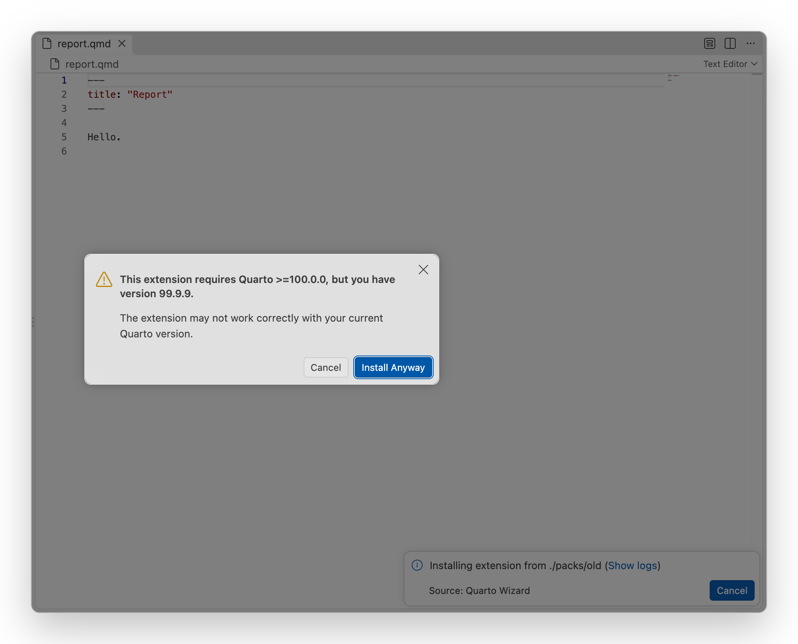{
.light-content .lightbox
.img-fluid .img-thumbnail .rounded-3 .border-light
fig-align="center" group="quarto-wizard-light"
fig-alt=''
}
:::

::: {.callout-note}
The Quarto VS Code extension is optional.
If it is not installed, version validation is silently skipped and the installation proceeds normally.
Quarto Wizard will never prompt you to install the Quarto extension.
:::

::: {.callout-warning}
Installing an extension with an unmet version requirement may result in the extension not working correctly.
Consider updating your Quarto CLI to the required version for best results.
:::

## Trust and Confirmation

By default, Quarto Wizard asks for confirmation before:

- Trusting a new extension author.
- Installing an extension.

You can adjust these prompts in [Configuration](../reference/configuration.qmd).

::: {.callout-note}
Quarto Wizard can only display information provided by extension authors.
If an author has not provided a description, licence, or version tags, these fields will show "none".
:::
