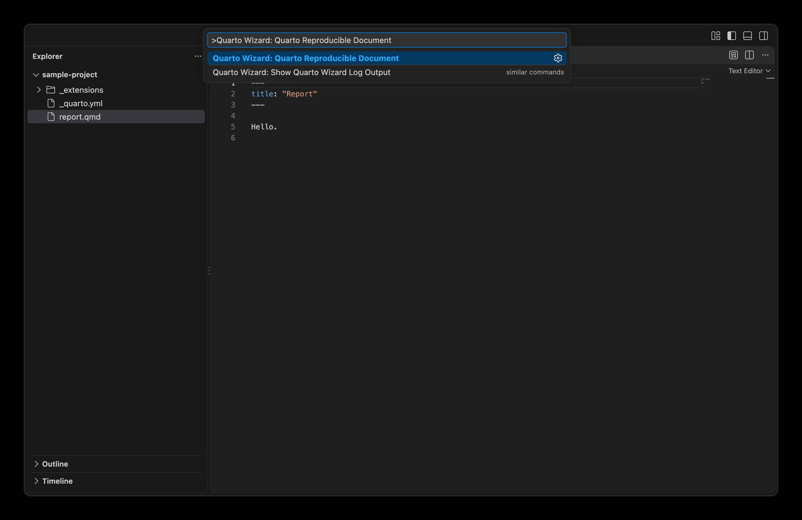
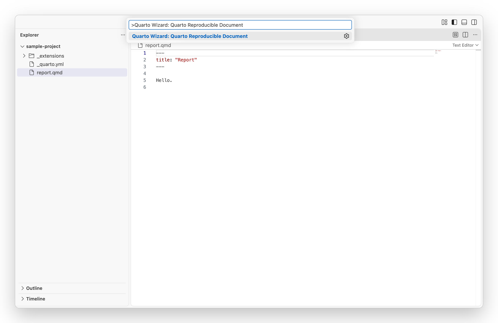
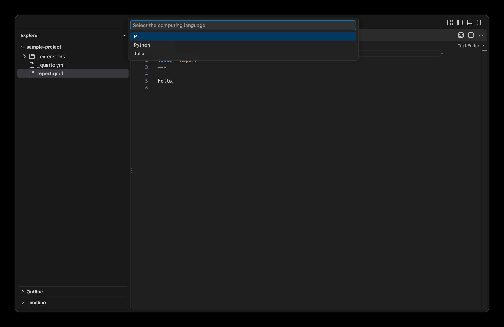
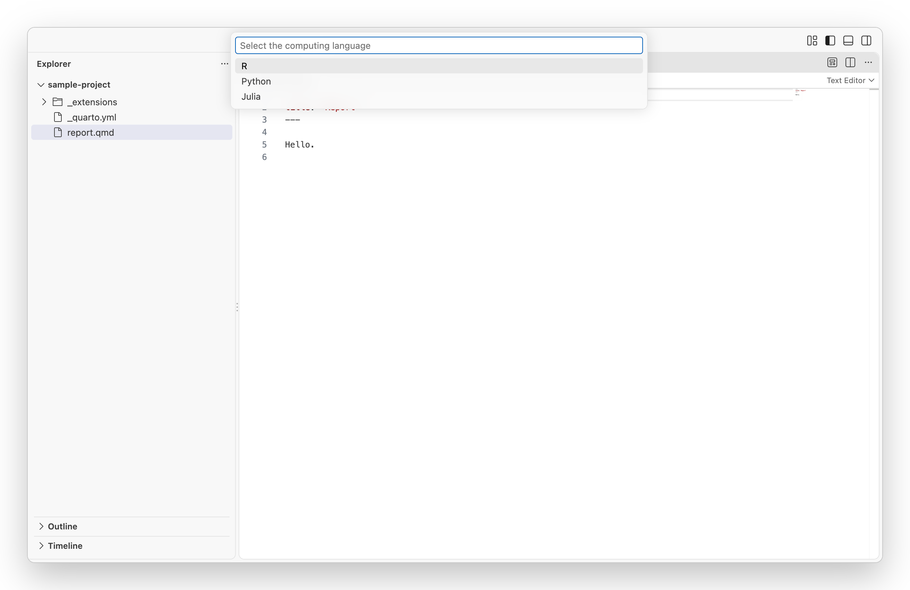

Quarto Wizard can create reproducible example documents (reprex) for R, Python, and Julia.
These are useful for bug reports, feature requests, or sharing code examples.

## Creating a Reproducible Document

1. Open the Command Palette (`Ctrl+Shift+P` or `Cmd+Shift+P` on macOS).
2. Type `Quarto Wizard: Quarto Reproducible Document` and select it.
3. Choose the language: R, Python, or Julia.
4. A new untitled document opens in the editor with a ready-to-use template.

::: {layout="[[1, 1], [-0.25, 0.5, -0.25]]"}

::: {style="text-align: center;"}
{
.dark-content .lightbox
.img-fluid .img-thumbnail .rounded-3 .border-light
fig-align="center" group="quarto-wizard-dark"
fig-alt=''
}
{
.light-content .lightbox
.img-fluid .img-thumbnail .rounded-3 .border-light
fig-align="center" group="quarto-wizard-light"
fig-alt=''
}
:::

::: {style="text-align: center;"}
{
.dark-content .lightbox
.img-fluid .img-thumbnail .rounded-3 .border-light
fig-align="center" group="quarto-wizard-dark"
fig-alt=''
}
{
.light-content .lightbox
.img-fluid .img-thumbnail .rounded-3 .border-light
fig-align="center" group="quarto-wizard-light"
fig-alt=''
}
:::

::: {style="text-align: center;"}
{
.dark-content .lightbox
.img-fluid .img-thumbnail .rounded-3 .border-light
fig-align="center" group="quarto-wizard-dark"
fig-alt=''
}
{
.light-content .lightbox
.img-fluid .img-thumbnail .rounded-3 .border-light
fig-align="center" group="quarto-wizard-light"
fig-alt=''
}
:::

:::

## Use Cases

Reproducible documents are helpful for:

- **Bug reports**: Share a minimal example that reproduces an issue.
- **Feature requests**: Demonstrate a desired behaviour.
- **Stack Overflow questions**: Provide complete, runnable code.
- **Documentation**: Create examples that others can verify.

## Best Practices

When creating a reproducible example:

1. **Keep it minimal**: Include only the code necessary to demonstrate the issue.
2. **Use built-in datasets**: Avoid dependencies on external data files.
3. **Include package versions**: The templates automatically capture this information.
4. **Test your example**: Ensure it runs from start to finish without errors (unless the error is what you're demonstrating).

## Accessing from Other Locations

You can also create reproducible documents from:

- **File > New File** menu: Select "Quarto Reproducible Document".
- **Context menu**: Right-click and select Quarto Wizard > Quarto Reproducible Document.
