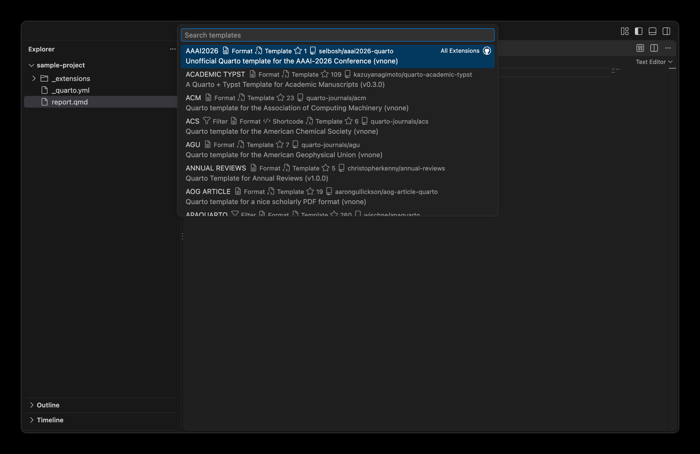
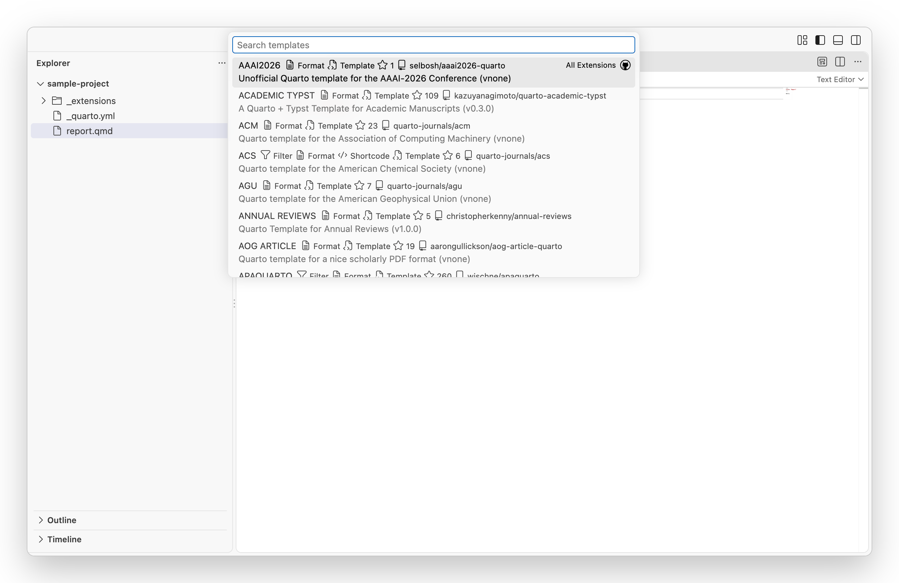
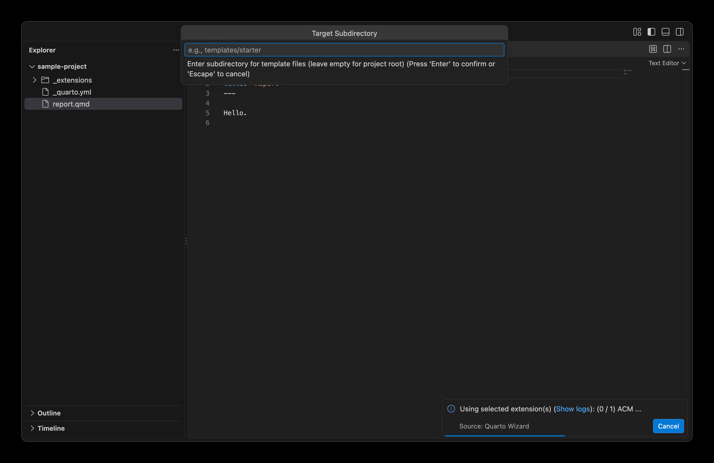
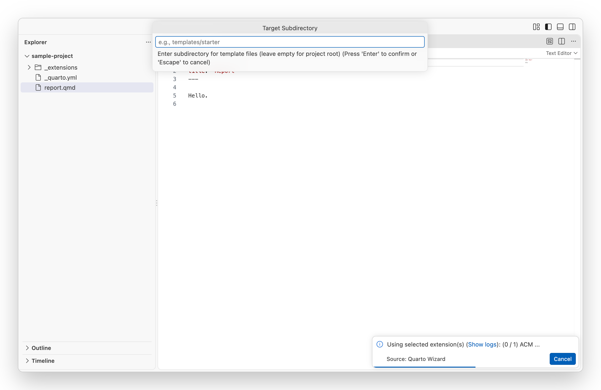
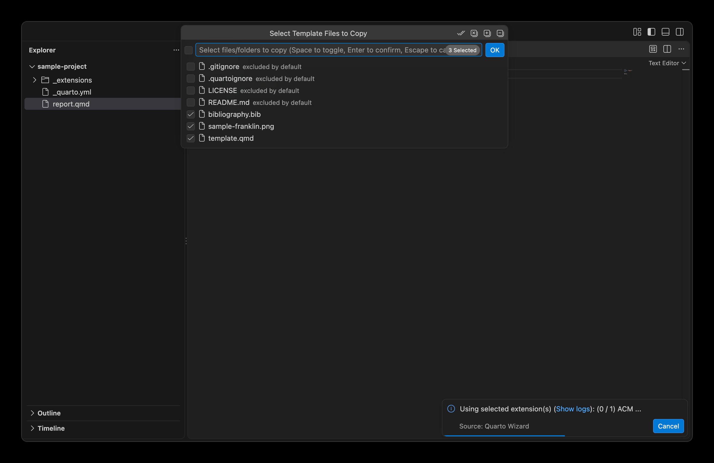
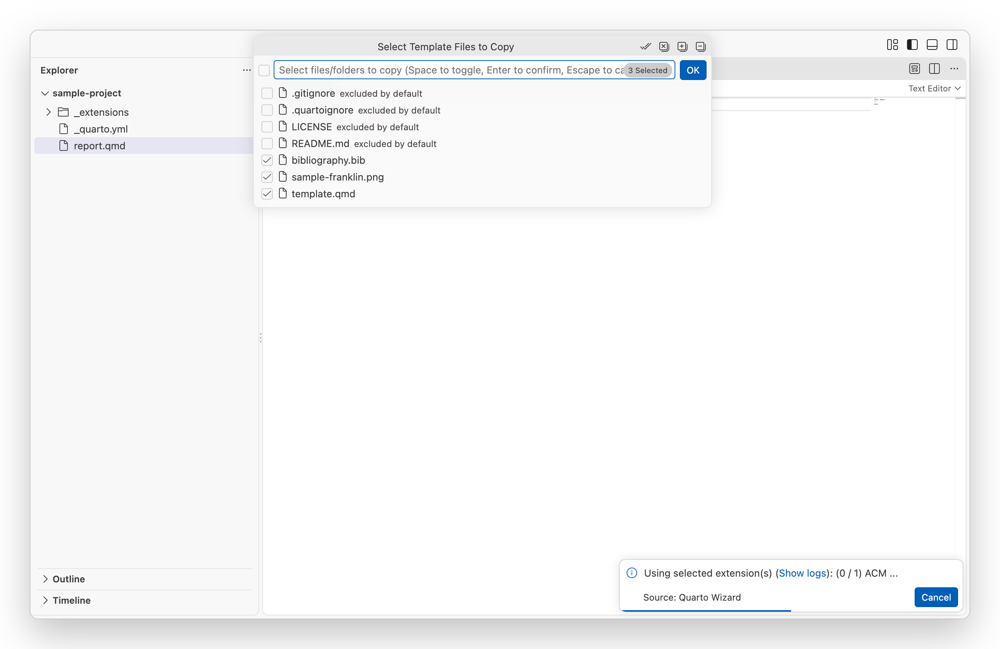

Quarto Wizard allows you to quickly start new documents using pre-configured templates from the extension registry, GitHub repositories, URLs, or local paths.

## What are Templates?

Templates are special Quarto extensions that include starter files for specific document types, such as:

- Academic papers.
- Presentation slides.
- Letters and invoices.
- Journal article formats.

When you use a template, Quarto Wizard:

1. Installs the extension.
2. Copies the template files to your workspace.

## Using the Template Browser

1. Open the Command Palette (`Ctrl+Shift+P` or `Cmd+Shift+P` on macOS).
2. Type `Quarto Wizard: Use Template` and select it.
3. Select an installation source (Registry, GitHub, URL, or Local).
4. For Registry: browse the list of available templates.

::: {layout-ncol="2"}

::: {style="text-align: center;"}
{
.dark-content .lightbox
.img-fluid .img-thumbnail .rounded-3 .border-light
fig-align="center" group="quarto-wizard-dark"
fig-alt=''
}
{
.light-content .lightbox
.img-fluid .img-thumbnail .rounded-3 .border-light
fig-align="center" group="quarto-wizard-light"
fig-alt=''
}
:::

::: {style="text-align: center;"}
{
.dark-content .lightbox
.img-fluid .img-thumbnail .rounded-3 .border-light
fig-align="center" group="quarto-wizard-dark"
fig-alt=''
}
{
.light-content .lightbox
.img-fluid .img-thumbnail .rounded-3 .border-light
fig-align="center" group="quarto-wizard-light"
fig-alt=''
}
:::

:::

## Installing a Template

1. Select the template you want to use.
2. Choose the workspace folder where the template should be installed (if multiple are available).
3. Specify a target subdirectory for template files (optional).
4. Select which template files to copy.
5. Confirm any file overwrites if necessary.

::: {layout-ncol="2"}

::: {style="text-align: center;"}
{
.dark-content .lightbox
.img-fluid .img-thumbnail .rounded-3 .border-light
fig-align="center" group="quarto-wizard-dark"
fig-alt=''
}
{
.light-content .lightbox
.img-fluid .img-thumbnail .rounded-3 .border-light
fig-align="center" group="quarto-wizard-light"
fig-alt=''
}
:::

::: {style="text-align: center;"}
{
.dark-content .lightbox
.img-fluid .img-thumbnail .rounded-3 .border-light
fig-align="center" group="quarto-wizard-dark"
fig-alt=''
}
{
.light-content .lightbox
.img-fluid .img-thumbnail .rounded-3 .border-light
fig-align="center" group="quarto-wizard-light"
fig-alt=''
}
:::

:::

## Target Subdirectory

When using a template, you can specify a subdirectory where the template files should be copied.
This is useful when you want to organise your project or avoid overwriting existing files in the project root.

- Leave the field empty to copy files directly to the project root.
- Enter a relative path (e.g., `my-project` or `docs/templates`) to copy files to that subdirectory.

::: {.callout-note}
Extensions are always installed to the `_extensions/` directory at the project root, regardless of the target subdirectory setting.
Only template files (e.g., `.qmd` documents, stylesheets) are affected by the target subdirectory.
:::

## Template Files

Templates typically include:

- A `.qmd` starter document.
- Custom styling files (CSS, SCSS).
- Configuration files.
- Example content.

::: {.callout-note}
The "Use Template" command retrieves all files from the template repository and allows you to select which ones to copy.
Common repository files (such as README, LICENSE, and Git configuration) are excluded by default, but you can include them if needed.
Anything listed in the template repository's `.quartoignore` starts unselected as well, so a documentation website or a scratch directory is not copied unless you tick it back on.
:::

## Recently Used Templates

Quarto Wizard keeps track of your recently used templates for quick access.
These appear at the top of the template browser.

To clear this list, use `Quarto Wizard: Clear Recently Installed Extensions` (this also clears the recently installed extensions list).

## Accessing Templates from Context Menu

You can also access the template browser from:

- The Explorer context menu (right-click in the file explorer).
- The Editor context menu (right-click in an editor).
- The Quarto Wizard Explorer View toolbar.
